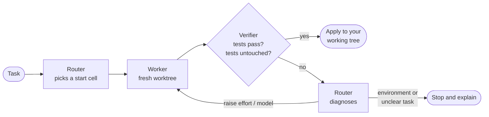

<div align="center">

# 🪜 model-ladder

**Start every coding task on the cheapest model that can do it. Climb only when your tests say so.**

[](https://github.com/neilyonglu/model-ladder/actions/workflows/test.yml)
[](https://code.claude.com/docs/en/plugins)
[](CHANGELOG.md)
[](https://nodejs.org)
[](LICENSE)
[](#-is-it-worth-it-for-you-claude-code)

[Claude Code install](#-install-claude-code) · [Claude Code use](#-use-claude-code) · [Codex](#codex) · [How it works](#-how-it-works) · [Claude Code benchmark](#-is-it-worth-it-for-you-claude-code) · [Claude Code configure](#-configure-claude-code) · [Design](DESIGN.md)

</div>

---

model-ladder is a plugin for coding agents. The same plugin package runs on [Claude Code](https://code.claude.com) and Codex. It runs your task on a cheap model at low effort in an isolated git worktree, checks the result with your own tests, and moves up a model × effort grid only when an attempt fails. A router decides each move from what actually went wrong, and code makes sure it only ever moves up.

Claude Code example:

```text
/model-ladder:run Fix the typo in the welcome message
```

```text
model-ladder ── VERIFIED

Task      Fix the typo in the welcome message
Verify    uv run pytest tests/test_messages.py
Tests     protected (router: Bug fix; the existing test defines expected behavior.)
Start     haiku/low (router: One-character typo "Wellcome" in shop/messages.py; existing test already asserts the correct text.)

#  Model / Effort   Result   Why next
1  haiku / low      PASS     —

Changed   shop/messages.py
Applied   to the working tree (not committed)
Tokens    3228 output (route + attempts)
```

## Codex

The same repository contains both plugin manifests. Claude Code keeps its existing installation and `/model-ladder:run` command. In Codex CLI 0.160.1 or later, install the same package with:

```sh
codex plugin marketplace add neilyonglu/model-ladder
codex plugin add model-ladder@model-ladder
```

For a local checkout, replace `neilyonglu/model-ladder` with the checkout's absolute path. Restart the Codex session after installation, then invoke the `model-ladder` skill with your task. The skill resolves its runner from its own installed path. Node 20+, Git and an authenticated native `codex` executable must be available on PATH. Set `CODEX_BINARY` to an absolute native executable path when needed. No separate package, proxy or API key is required.

### Use ladder by default in Codex

On by default: the plugin's session-start hook tells Codex that top-level coding tasks in a Git repository go through the model-ladder skill, unless you ask to skip it. Codex asks you to trust plugin hooks once: run `codex`, open `/hooks`, review and trust model-ladder's hook, and start a new thread. Nothing goes into `~/.codex/AGENTS.md`, so a new machine needs no setup.

To turn it off, set `MODEL_LADDER_AUTORUN=0` in the environment Codex starts from, or leave the hook untrusted. This is an instruction-based default, subject to higher-priority and project instructions. It does not replace the parent session's model or guarantee that every message launches a ladder run.

### Run the Codex runner directly

The runner can also be called directly from the target repository:

```sh
node /path/to/model-ladder/scripts/codex-run.mjs "Fix the greeting typo"
```

To supply acceptance criteria or consent to existing changes, pass JSON on stdin through your platform's literal-input support:

```json
{"task":"Fix the greeting typo","acceptance":["The greeting says Welcome"],"allowDirty":true}
```

On Windows PowerShell, save that JSON in a UTF-8 file and use the file input. Windows PowerShell's default pipe encoding can replace Chinese and other non-ASCII text with question marks. UTF-8 files with a BOM are supported.

```sh
node /path/to/model-ladder/scripts/codex-run.mjs --input /path/to/task.json
```

Place input files inside `.model-ladder/` or outside the repository so they do not count as uncommitted source changes. Only `VERIFIED` exits with code 0. `DIRTY`, `NEEDS_INPUT`, and `STALE_RUN` exit with code 2; failures exit with code 1. Inspect the JSON result in each case.

Configure Codex separately in `.codex/model-ladder.json`. Defaults use the locally available model metadata checked for this release; availability depends on the account. An unavailable model, unsupported effort, authentication failure or sandbox failure stops the run. Replace the model IDs and efforts with ones your account exposes.

```json
{
  "router": { "model": "gpt-5.6-terra", "effort": "low" },
  "verifier": { "model": "gpt-6-luna", "effort": "low" },
  "tiers": [
    { "model": "gpt-6-luna", "efforts": ["low", "medium", "high"], "maxEffortJump": 2 },
    { "model": "gpt-5.6-terra", "efforts": ["low", "medium", "high"], "maxEffortJump": 2 },
    { "model": "gpt-6.1-sol", "efforts": ["low", "medium", "high", "xhigh"], "maxEffortJump": 1 }
  ],
  "maxAttempts": 4,
  "verify": "npm test",
  "protected": [],
  "keepFailed": false,
  "timeoutMs": 600000,
  "usageGuard": { "enabled": true, "threshold": 90 }
}
```

`usageGuard` is on by default: before each role and the verify command the runner reads the latest Codex session `rate_limits`, and at or above `threshold` percent it stops with `USAGE_LIMIT`, keeps the checkpoint and writes `HANDOFF.md` (`handoffPath`). Unknown or expired usage never blocks. Turn it off with `{"usageGuard": {"enabled": false}}`.

### Codex progress and live monitor

The runner prints a progress table to stderr whenever a role starts or ends, showing quota usage, model/effort, elapsed time, phase and task. Its final result on stdout stays JSON. Routing, workers, diagnosis, the verification command and the independent verifier are included; `node/—` identifies the verification command. Successful roles show `✓`, failed or interrupted roles show `✗`, and completed times stop advancing. A role's success means that role completed successfully; only the final `VERIFIED` result approves the task.

For a table that refreshes every second, open another terminal in the task repository:

```sh
node /path/to/model-ladder/scripts/watch.mjs
# Or select the task repository explicitly:
node /path/to/model-ladder/scripts/watch.mjs --cwd /path/to/task-repo
```

```text
▴ model-ladder ── 5h 15% · 7d 44%
model/effort          time       task
gpt-6-luna/low        ✓ 5s       route: Fix the greeting typo
gpt-6.1-sol/medium    12s        worker: Fix the greeting typo
[usage guard: on]  threshold 90%
```

The monitor truncates long tasks to the terminal width, counts Chinese characters as two cells, and removes completed rows ten seconds after completion. The header shows `idle` when no role is running. Ctrl-C stops the monitor without stopping the runner. Redirected output appends snapshots instead of using terminal redraw sequences.

Configure the guard through monitor arguments (settings are saved before monitoring starts):

```sh
node /path/to/model-ladder/scripts/watch.mjs --guard off
node /path/to/model-ladder/scripts/watch.mjs --guard on --threshold 90
```

`--threshold` accepts finite numbers from 1 through 100, including decimals; invalid arguments exit with an error before writing anything. Updates preserve other fields in `.codex/model-ladder.json`. A running ladder reloads the guard at the next role or verification-command boundary; it does not interrupt an already running role. The threshold is displayed only while the guard is enabled. Changing configuration can invalidate a saved resume checkpoint, which requires the original configuration.

The runner atomically replaces `.model-ladder/live.json` at role start/end and during final cleanup, including handled cancellation and idle timeout. It contains `{ runId, updatedAt, agents: [{ phase, model, effort, task, startedAt, endedAt, pass }], usage: { fiveHour, sevenDay } }`; timestamps are ISO strings and active rows have `endedAt: null, pass: null`. The latest run replaces the previous table. The monitor reads this file and refreshes usage independently through the same `readCodexUsage` implementation as the runner.

Usage is the latest locally recorded Codex session's quota percentage, not this ladder's token cost or a live account query. Only unexpired windows explicitly identified as 300 or 10080 minutes are labelled 5h or 7d; absent, expired or unidentifiable windows show `?`. The guard still checks the highest percentage across all unexpired windows. Hard termination such as SIGKILL or power loss cannot write final state and can leave an active row behind.

This is terminal output. Whether Codex app expands running tool output is controlled by the app; the plugin does not install a persistent composer panel or clickable switch.

Run `node tests/e2e/codex-live-smoke.mjs` for an offline runner/monitor demonstration with `tests/helpers/fake-codex.mjs`. It creates a disposable Git fixture, checks running and completed rows, waits for the ten-second removal, then cleans up; no authenticated model call is made. Add `--terminal` to visually inspect the monitor's redraw in your terminal instead of capturing and asserting its output.

`verify` is an existing trusted project command, run by Node and judged by its exit status. Without it, Codex follows `.agents/skills/verify/SKILL.md` or `.claude/skills/verify/SKILL.md` when present; otherwise it discovers an existing npm, pytest, Cargo, Go, Maven or Make test command. If none exists, the user must supply explicit acceptance criteria before work begins. A separate model always checks the task and any supplied criteria after command checks pass. For editing tasks, this verifier can write build artifacts in the isolated worktree; source and verification inputs remain protected by checks after verification. Report verifiers remain read-only. The router never invents a shell command to execute.

Codex starts every attempt from the same commit plus the user's approved dirty snapshot. Tests and both ladder configuration files stay protected, except tests may change for test-writing tasks. Protection compares actual Git trees before and after verification, including tests the user had already edited. User staging stays unchanged. Read-only reports run in isolated read-only worktrees and return their full report without applying anything.

Successful patches are applied to the working tree without committing or pushing. A conflicting patch is retained with its verified worktree. Cleanup removes only this run's worktrees. Both runtimes use the same exclusive run marker, so they cannot apply concurrent ladder runs in the same checkout. Inspect an abandoned `.model-ladder/run.json` before removing it. SIGINT, SIGTERM and per-command idle timeouts stop child processes and release the marker. Result JSON, bounded CLI event/error logs, usage and history remain under `.model-ladder/`, including partial logs on timeout or cancellation. Add that directory to `.gitignore`.

Interrupted workers and verifiers retain their unverified worktree and return `checkpointPath` and `resumeRun`. To continue, add that `resumeRun` to the original input JSON and invoke the runner again. Keep the original task, acceptance criteria, and authorized `allowDirty` value. Resume requires the same repository commit, source snapshot, and ladder configuration. The runner checks protected files, starts a new worktree containing the draft, and repeats verification before applying changes. The source worktree remains available for inspection. `timeoutMs` is an idle limit, not a deadline: a role or verify command runs as long as it keeps producing output and stops only after `timeoutMs` without any; the Codex skill automatically resumes a timeout at most twice.

Newly generated artifact files under paths such as `dist`, `build`, and `target` are excluded from patch and tampering comparisons. Files already present in the baseline Git tree remain checked and included in patches, even under artifact paths.

On Windows, the Codex workspace-write sandbox must be working before a worker can run. A host sandbox setup or ACL error stops the run; repair the Codex sandbox setup and retry. The runner does not weaken sandbox settings automatically.

Codex protects npm scripts (including nested package manifests), npm configuration, and the selected verification skill directory. For other discovered verifiers, the selected build manifests are protected as whole files; edit those manifests outside a ladder run. Use `protected` for custom verification helpers outside conventional test paths.

Run `node --test tests/unit/*.test.mjs` for offline integration checks. Run `node tests/e2e/codex-smoke.mjs` only when you want a real authenticated model call; it creates a temporary Git fixture, verifies the fix and preserves failed runs for inspection. Optional `MODEL_LADDER_SMOKE_MODEL` and `MODEL_LADDER_SMOKE_EFFORT` select an available cell.

The Claude benchmark below measures Claude only. Codex costs and the Claude parent-context DIRECT shortcut are not inferred from it.

### Model selection reviewed on 2026-10-21

The following comparison matches product positioning, not equal performance. Prices are Standard API USD per million uncached input/output tokens for short prompts. Haiku's listed rate applies up to 100,000 input tokens. These are not subscription usage rates. Sources: [Anthropic pricing](https://platform.claude.com/docs/en/about-claude/pricing) and [OpenAI pricing](https://developers.openai.com/api/docs/pricing).

| Workload tier | Claude | OpenAI | Claude input/output | OpenAI input/output |
|---|---|---|---|---|
| Focused, high-volume work | Haiku 5.5 | GPT-6 Luna | $0.10 / $0.50 | $0.10 / $0.50 |
| General coding and agent work | Sonnet 5.5 | GPT-6.1 Sol | $2 / $10 | $2 / $10 |
| Demanding, sustained work | Opus 5.5 | GPT-6 Astra | $4 / $20 | $10 / $50 |

Codex defaults mirror the Claude defaults role for role: Luna for Haiku, Terra for Sonnet, Sol for Opus. The router runs on `gpt-5.6-terra/low` and the semantic verifier on `gpt-6-luna/low`. This is a documented starting configuration, not a measured optimum. The router reads the repository, chooses a start cell and diagnoses failed attempts. The semantic verifier judges acceptance, reports or a project verification skill. Unlike Claude's cheap command verifier, Codex runs ordinary test commands in Node, so that path needs no verifier model.

[OpenAI's model guide](https://learn.chatgpt.com/docs/models) recommends starting Sol at the effort available by default in the client. The local Codex model catalog checked for this release reports `low` for Sol. The [API model page](https://developers.openai.com/api/docs/models/gpt-6.1-sol) instead documents `medium` as its API default; this runner explicitly sets effort. Claude and OpenAI effort labels do not establish equivalent reasoning budgets or quality.

[OpenAI's selection guidance](https://developers.openai.com/api/docs/guides/model-selection) positions Luna for scoped tasks and triage, and Sol for complex work with cost constraints. Luna is therefore a candidate for cheaper routing, but public model comparisons do not show that it preserves this plugin's routing or verification accuracy. [Anthropic's Haiku evaluation](https://www.anthropic.com/claude-haiku-5-5) also reports different Haiku/Luna results despite their similar positioning. No role-specific model or effort comparison has been run here. The 91 offline tests validate orchestration, not model quality. Measure routing errors, incorrect verification passes, latency and usage on the same tasks before replacing these defaults.

## ✨ Features

- **Cheap first.** Starts at the lowest cell likely to succeed, not the strongest model "to be safe".
- **Verified, not claimed.** Only a change that passes your tests reaches your working tree.
- **Smart escalation.** Raises effort when the worker was close, switches model when it lacked knowledge, and stops when the problem is the environment or an unclear task.
- **Anti-cheat.** Workers cannot edit your tests or the ladder config to make a run pass.
- **Safe by default.** Every attempt runs in a throwaway worktree. Nothing is committed unless you ask, and nothing is ever pushed.
- **Tunable per project.** One optional JSON file sets the grid, and every run is logged so you can see where it climbs.

## 📊 Is it worth it for you? (Claude Code)

Seven small tasks (from a typo to "implement this spec"), one run each, list-price cost reported by Claude Code:

| Strategy | Solved | Cost per solved task |
|---|:---:|---:|
| **model-ladder** | 7/7 | **$0.18** |
| always sonnet / high | 7/7 | $0.13 |
| always opus / xhigh | 7/7 | $0.31 |

> [!TIP]
> **You run everything on Opus or a high effort?** model-ladder solved the same tasks for **42% less**.

> [!NOTE]
> **You already run Sonnet on small tasks?** model-ladder costs more and is slower. Orchestrating a run costs about one extra session, and on small tasks that is more than a cheaper worker saves. Large tasks, where a fixed run costs the most and the overhead matters least, are not measured yet.

Cost breakdown and caveats: [DESIGN.md › Benchmark](DESIGN.md#benchmark).

## 🧭 How it works



The Claude Code grid it climbs (see the Codex section for its model IDs):

```text
          low   medium   high   xhigh
haiku      ●      ●       ●
sonnet     ●      ●       ●
opus       ●      ●       ●       ●
```

A move only goes up: a higher effort within the same model (opus one step at a time), or the next model at any effort. It never skips from haiku straight to opus.

Claude Code roles:

| Role | Runs on | Does |
|---|---|---|
| Router | sonnet / low, read-only | Picks the start, finds your verify step, diagnoses each failure |
| Worker | the current cell | Implements the task in a fresh git worktree |
| Verifier | haiku / low | Checks protected files, runs your tests |

## 📦 Install (Claude Code)

```text
/plugin marketplace add neilyonglu/model-ladder
/plugin install model-ladder@model-ladder
```

Where `/plugin` is not available, such as the Claude Code extension for VS Code, install from a terminal instead. The extension shares the same settings; reload its window afterwards.

```sh
claude plugin marketplace add neilyonglu/model-ladder
claude plugin install model-ladder@model-ladder
```

**Everything is on after install.** Open any git repository and run `/model-ladder:run <task>`; no setup file is needed:

- **The ladder by default**: at the start of each session the plugin tells Claude that top-level coding tasks in a git repository go through `/model-ladder:run`, unless you say to skip it ("no ladder", "do it directly"). Conversation, status checks, git, settings and docs are handled directly. Nothing goes into `CLAUDE.md`, so a new machine needs no setup.
- **The ladder**: cheapest model first, verified, escalated on failure.
- **The band** above the prompt: subscription usage, the ladder agents running now, and the usage guard switch. See [Claude Code band](#claude-code-band).
- **The usage guard**: a run does not start, or stops after an attempt, once the 5-hour or weekly limit reaches 90%. It leaves a `HANDOFF.md` to pick up from. See [Claude Code usage guard](#claude-code-usage-guard).
- **The guard hook**: workers cannot edit tests or the ladder config unless the task is about tests.

To turn any of these off, see [Turn features off](#turn-features-off).

**Requirements**

- Claude Code with the Workflow tool (paid plans; on Pro, enable it in `/config`). Tested on 2.1.296.
- git, and Node.js 20 or later on `PATH`.
- A git repository with at least one commit.

**Recommended**

Add model-ladder's working folders to `.gitignore`:

```text
.model-ladder/
.claude/worktrees/
```

Skip the approval prompt for each run by allowing the Workflow tool, for example in `.claude/settings.json`:

```json
{ "permissions": { "allow": ["Workflow"] } }
```

**Updates**

Claude Code does not auto-update plugins from third-party marketplaces unless you turn it on: `/plugin` → **Marketplaces** → **model-ladder** → **Enable auto-update**. Otherwise update by hand:

```sh
claude plugin update model-ladder@model-ladder
```

Either way, the end of a model-ladder report tells you when a newer version is out. What changed in each version: [CHANGELOG.md](CHANGELOG.md). To get notified on GitHub, **Watch** → **Custom** → **Releases**.

## 🚀 Use (Claude Code)

```text
/model-ladder:run <task>
```

A small task (one or two files, with the design already written) in a long session (above about 300k tokens of context) is done directly, without the ladder: orchestration re-reads the session's context, so in a long session it costs more than a cheaper worker saves. The router makes this call after reading the code. Start the task with `--ladder` to force the ladder:

```text
/model-ladder:run --ladder <task>
```

model-ladder asks before it acts when:

- you have uncommitted changes (it can build on them; they are never part of its patch),
- the task is too vague to act on,
- the repo has no tests for the task, so you confirm what "done" means,
- `CLAUDE_CODE_EFFORT_LEVEL` or `CLAUDE_CODE_SUBAGENT_MODEL_FORCE` is set, since either overrides every attempt's model or effort.

## 🔧 Configure (Claude Code)

Optional, per project: `.claude/model-ladder.json`. Each key you set replaces its default.

| Key | Default | Meaning |
|---|---|---|
| `router` | `{ "model": "sonnet", "effort": "low" }` | Picks the start, diagnoses failures |
| `verifier` | `{ "model": "haiku", "effort": "low" }` | Runs the verify command (the router's model judges when there is none) |
| `tiers` | haiku low–high, sonnet low–high, opus low–xhigh | The grid, weakest model first; `maxEffortJump` caps effort steps per move (2, 2, 1) |
| `maxAttempts` | `4` | Attempts before giving up |
| `verify` | found by the router | Command that proves the task is done |
| `protected` | `[]` | Extra globs no worker may modify |
| `commit` | `false` | Commit the verified change |
| `keepFailed` | `false` | Keep failed attempts' worktrees for debugging |
| `usageGuard` | `{"enabled": true, "threshold": 90}` | Stop at `threshold` percent (1-100) of the subscription's 5-hour or weekly limit; see [Claude Code usage guard](#claude-code-usage-guard). Set either field alone, e.g. `{"usageGuard": {"enabled": false}}` |

### Claude Code usage guard

On by default. It stops the ladder before it uses up your Claude subscription (Pro/Max) limit:

- Before a run: at or above `threshold` percent (default 90) of the 5-hour or weekly limit, the run does not start.
- After each failed attempt: the verifier re-reads the usage. At the threshold the run stops with `USAGE_LIMIT`, keeps the last attempt's worktree and writes `.model-ladder/HANDOFF.md`. Run `/model-ladder:run` again after the limit resets.

An attempt in progress is never interrupted. Unknown usage never blocks: preflight then shows a note and the run goes on.

**Where the usage comes from.** The band records it from Claude Code into `.model-ladder/usage.json` in the project, so there is nothing to set up. If the band cannot load (an older Claude Code) or you use an API key, there is no usage to read. A statusline can supply it instead. Copy the plugin's `scripts/usage-statusline.mjs` to `~/.claude/model-ladder-usage-statusline.mjs` (the plugin cache path changes with every version), then add this to `~/.claude/settings.json`:

```json
"statusLine": { "type": "command", "command": "node ~/.claude/model-ladder-usage-statusline.mjs", "refreshInterval": 60 }
```

Only Pro/Max plans report usage. A reading older than 15 minutes counts as unknown.

<details>
<summary>Example: a three-rung ladder that commits</summary>

```json
{
  "tiers": [
    { "model": "haiku",  "efforts": ["low"],           "maxEffortJump": 1 },
    { "model": "sonnet", "efforts": ["medium", "high"], "maxEffortJump": 1 },
    { "model": "opus",   "efforts": ["high"],           "maxEffortJump": 1 }
  ],
  "verify": "npm test",
  "commit": true
}
```

</details>

Models are aliases (`haiku`, `sonnet`, `opus`), so new model versions are picked up automatically.

Every run appends a line to `.model-ladder/history.jsonl`: which cells were tried, why each move was made, and the tokens spent. Use it to tune the grid, for example to start at haiku/medium if haiku/low keeps failing.

### Claude Code band

A band above the prompt shows the ladder live. It is on after install.

<p align="center"></p>

While a run is going, each ladder agent gets a row:

```
▴ model-ladder ── 5h 15% · 7d 44%
model/effort        time     task
haiku-5.5/low       ✓ 5s     Summarize the README install steps
sonnet-5.5/medium   12s      Collect the escalation rules…
[usage guard: on]  threshold [90] % [set]
```

- **Header**: the subscription usage (5-hour and weekly), and `idle` when no ladder agent runs. `▴`/`▾` folds the band to one line.
- **Rows**: each running agent's model/effort, time so far and task. A finished row shows `✓` for 10 seconds, then leaves. An agent still running after 10 minutes raises one notice; nothing stops it.
- **Controls**: `usage guard` turns the guard on or off. `threshold` is shown while the guard is on and takes a number from 1 to 100. Both write `.claude/model-ladder.json` and apply from the next run.

The band shows in the terminal, the desktop app and the VS Code extension. It needs Claude Code 2.1.290 or later. It lives in its own hooks file, so an older version that cannot load it still runs the ladder.

### Turn features off

| Feature | How to turn it off |
|---|---|
| Ladder by default | In Claude Code: `/plugin configure model-ladder`, set **Use the ladder by default** off; or from a terminal: `echo '{"autoRun":"false"}' \| claude plugin configure model-ladder@model-ladder --values-stdin`. Either runtime: set `MODEL_LADDER_AUTORUN=0`. You can still run `/model-ladder:run <task>` yourself. |
| Band | In Claude Code: `/plugin configure model-ladder`, set **Show the band** off. From a terminal (also for VS Code): `echo '{"band":"false"}' \| claude plugin configure model-ladder@model-ladder --values-stdin`. The usage guard keeps working with the band hidden. |
| Usage guard | Press `usage guard` in the band, or set `{"usageGuard": {"enabled": false}}` in `.claude/model-ladder.json` (per project). |
| Threshold | Type it in the band, or set `{"usageGuard": {"threshold": 95}}`. |
| The whole plugin | `/plugin disable model-ladder@model-ladder`, or `claude plugin disable model-ladder@model-ladder`. |

## 🛡️ Safety

- Workers run in throwaway git worktrees. Only a verified change reaches your working tree, and it is never committed unless `commit` is true. Nothing is ever pushed.
- Workers may not touch tests unless the task is about tests, and never the ladder config. Claude Code blocks such edits with a hook and checks them again in verification. Codex rejects protected changes before verification and patch application.
- If you edit the same files while a run is going, the change is not forced in; the worktree and patch are kept and the report says where.

## ⚠️ Limitations

- Claude Code and Codex use separate runtime settings within the same plugin package.
- Claude Code orchestration costs about one session per run regardless of task size.
- Token counts in the report cover the router, workers and verifier, not the orchestrating session.
- The benchmark is seven small tasks with one run each.

## 🧪 Development

```sh
node --test tests/unit/*.test.mjs            # 105 tests, no dependencies, no model calls
node tests/e2e/run.mjs --dry                 # plant every scenario and run pytest, no model calls
node tests/e2e/run.mjs [scenario ...]        # end-to-end via claude -p (about $0.2 per scenario)
node tests/e2e/bench.mjs                     # 7 tasks x 3 strategies (about $4.5)
node tests/e2e/codex-smoke.mjs               # real Codex write-and-verify smoke test
```

The Claude end-to-end scripts need `claude` and `uv` on `PATH`. The Codex smoke test needs an authenticated native `codex` executable and a working workspace-write sandbox. Design decisions, spike results and lessons from real runs are in [DESIGN.md](DESIGN.md).

### Local validation on 2026-10-21

These results were observed locally on Windows with Node.js 24.20.0 and Codex CLI 0.160.1. They are separate from the GitHub Actions badge above.

| Check | Result |
|---|---|
| Complete offline suite, run from the updated project | **91 passed, 0 failed** |
| Codex installation from this checkout | Passed in a temporary `CODEX_HOME`; plugin enabled, skill present and installed CLI entry loads |
| Native Codex read-only task | Passed routing, worker and independent verification with a read-only sandbox and controlled `--ignore-user-config` invocation |
| Native Codex write task | **Blocked by the host Windows sandbox ACL error** `helper_unknown_error: read ACL run had errors`; no patch applied |

The offline suite uses a fake Codex process with real temporary Git repositories. It covers escalation and fallback, protected tests and verification inputs, npm workspace scripts, dirty snapshots and index preservation, exact patch bytes, conflicts, timeouts and cleanup. At that time, these checks did not establish that the native Codex write flow passed. No global settings or sandbox bypass flags were used.

### Codex automation follow-up on 2026-10-23

The production-role native smoke test passed on 2026-10-22 with a Sol router, Luna worker, and Sol verifier. The runner returned `VERIFIED`, applied only `greeting.mjs`, and preserved the Git index. The outer test process required normal permission escalation to locate the user's Codex home; child Codex sessions retained their read-only or workspace-write sandboxes. This supersedes the earlier native-write blocker above.

The runner now preserves interrupted drafts and partial logs, supports checked continuation with `resumeRun`, accepts UTF-8 JSON files on PowerShell, and verifies task completion independently after project tests. Tracked baseline files under artifact directories also participate in protection and patch checks.

The complete offline suite passed on 2026-10-23 with **105 passed, 0 failed**. Four new real-Git checks cover tracked artifact edits and deletions, ignored new artifacts, literal patch filenames, and verifier rebuilds against the original baseline. The updated runtime files were copied to the local installed plugin with backups, and their SHA-256 hashes matched this checkout.

## 🙏 Credits

The brief format and the "verifier on a fresh context" rule are adapted from [pstack](https://github.com/michael-denyer/pstack-claude) (MIT).

## 📄 License

Released under the [MIT License](LICENSE). Copyright (c) 2026 neilyonglu.

Found a problem? Please [open an issue](https://github.com/neilyonglu/model-ladder/issues).
