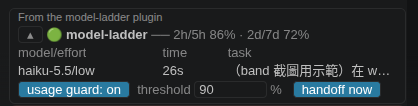

<div align="center">

# 🪜 model-ladder

**Route each task to a suitable model, complete it, verify the result, and deliver only after verification.**

[](https://code.claude.com/docs/en/plugins)
[](README.md#install)
[](CHANGELOG.md)
[](LICENSE)

[Install](#install) · [繁體中文](README.zh-TW.md) · [How to use](#how-to-use) · [Configure](#configure) · [Band](#band-claude-code) · [Usage guard](#usage-guard) · [Benchmark](#benchmark) · [Turn off](#turn-features-off) · [Design](DESIGN.md)

</div>

---

## What it does

model-ladder is a [Claude Code](https://code.claude.com) and Codex plugin. The Router selects a suitable model for each task, the Worker executes it, and the Verifier checks the result. Verified changes are delivered.

## Features

- **Isolated Git worktrees**: each attempt runs in its own worktree.
- **Escalation when appropriate**: verification failure may lead to a stronger model or higher effort.
- **Quota handoff document**: when usage approaches the configured quota and runtime conditions are met, `.model-ladder/HANDOFF.md` is created. The main session then rewrites it from your conversation (goal, preferences and decisions, done/not done, next steps, how to resume) and keeps the program-generated verification as an appendix.
- **The band / panel**: see active roles and usage, and create a handoff manually (`/model-ladder:handoff`).
- **Custom role instructions**: `worker_skills` and `verifier_skills` can direct workers and verifiers to use any available capability: skills, plugins, slash commands and MCP tools. Role agents inherit every session tool except Workflow and Agent.

## Install

Requires Git and Node.js 20 or later (the plugin does not install Node.js). Use it in a Git repository with at least one commit. In Codex, trust the plugin hooks in `/hooks` first.

Install and sign in to Claude Code first. For automation, make sure the Workflow tool is available. On Pro, enable it in `/config` before you install the plugin.

```text
# Claude Code
/plugin marketplace add usio0108/model-ladder
/plugin install model-ladder@model-ladder
```

```sh
claude plugin marketplace add usio0108/model-ladder
claude plugin install model-ladder@model-ladder

# Codex CLI 0.160.1+ (restart Codex afterwards; needs an authenticated native `codex`)
codex plugin marketplace add usio0108/model-ladder
codex plugin add model-ladder@model-ladder
```

Restart Claude Code after installing; top-level tasks then go through `/model-ladder:run` automatically. If the first run asks whether to allow Workflow, choose "don't ask again". model-ladder keeps `.model-ladder/` and `.claude/worktrees/` out of git itself (in `.git/info/exclude`), so you do not edit `.gitignore`. Update with `claude plugin update model-ladder@model-ladder` (automatic when the marketplace has auto-update on); reports announce new versions ([CHANGELOG.md](CHANGELOG.md)).

## How to use

Claude Code: `/model-ladder:run <task>`. Codex: ask for the `model-ladder` skill. Outside a git repo the assistant says it needs one and does the task directly; say "no ladder" to skip.

1. **Fix a bug**: `/model-ladder:run Fix the off-by-one in pagination`. haiku/low tries first and your tests pass, so the fix is applied. If it fails, the router moves to sonnet/medium and tries again.
2. **Build a feature with tests**: `/model-ladder:run Add a --json flag to the export command, with tests`. Because the task is about tests, workers may edit them. Otherwise tests are protected: a worker cannot change them to pass.
3. **Ask or review (nothing changes)**: `/model-ladder:run Review src/auth.ts and list risks`. The answer comes back in the report; no files are changed.
4. **Stopped by the usage guard**: `/model-ladder:run Migrate the settings module to the new config format`. After a failed attempt your 5-hour usage is at 90%, so the run returns `USAGE_LIMIT`, keeps the last worktree and writes `.model-ladder/HANDOFF.md`. Rerun after the reset.
5. **Small task returned as DIRECT**: `/model-ladder:run Rename the variable tmp to buffer in utils.py`. In a very long Claude session (over about 300k tokens) a small task is done directly by your session instead of by agents. The `model-ladder:verifier` agent (the config's `verifier` model and effort) then checks the diff independently; the session reports done only after it passes, and fixes and re-verifies after a failure. Add `--ladder` to force the ladder.

A finished run produces a report like this. Claude Code and Codex read it and send you one summary in the language you use in the session (status, changed files, verification, limits and follow-ups); file names, commands and paths stay as they are.

```text
model-ladder ── VERIFIED
Task      Fix the typo in the welcome message
Verify    uv run pytest tests/test_messages.py
Tests     protected (router: Bug fix; the existing test defines expected behavior.)
Start     haiku/low (router: One-character typo in shop/messages.py.)

#  Model / Effort   Result   Why next
1  haiku / low      PASS     —

Changed   shop/messages.py
Applied   to the working tree (not committed)
```

Verify is your test command and each table row is an attempt. It asks first for uncommitted changes, vague tasks, missing tests, or `CLAUDE_CODE_EFFORT_LEVEL` / `CLAUDE_CODE_SUBAGENT_MODEL_FORCE`. Runs are logged to `.model-ladder/history.jsonl`. Without a verify step, `/model-ladder:create-verification-skill` creates `.claude/skills/verify/` and `/model-ladder:maintain-verification-skill` updates it. Both are adapted from [pstack](https://github.com/michael-denyer/pstack-claude), MIT. See NOTICE.md.

Codex runner directly: `node scripts/codex-run.mjs "<task>"`; only `VERIFIED` exits 0. In Codex desktop, the session hook and ladder skill instruct Codex to start and show a persistent terminal panel automatically. Reuse it across tasks. You can also watch manually with `node scripts/watch.mjs [--cwd <repo>]`. If no terminal panel is available, the runner prints progress in the tool output. Codex uses router `gpt-5.6-terra/low`, verifier `gpt-6-luna/low` and tiers Luna, Terra, Sol (replace with models your account has); it has no `DIRECT` shortcut or `commit` option.

To show a one-line HUD in the same terminal as Codex CLI, run `npm ci`, then `node scripts/codex-hud.mjs --cwd <repo>` from this checkout (add `-- resume` to continue a session). On Windows, the wrapper needs a native `codex.exe` on PATH or set `CODEX_BINARY`; `.cmd` and `.bat` shims are rejected.

Concurrent runs: model-ladder runs whose files do not overlap can run at the same time in one repository, in Claude Code, in Codex, or one in each. Each run holds its own lock, `.model-ladder/runs/<runId>.json` (runtime, pid, protected and test patterns, scope). After the router names the files it expects to change, the run compares that scope with every other active run:

- No overlap: both runs go ahead.
- Overlap: the run stops before any worker and returns `NEEDS_INPUT` with `reason: "OVERLAP"` and the overlapping runs. Claude Code asks whether to wait; when the other run is done, it claims again. Codex returns the same status; rerun the same JSON when the other run is done. Nothing is overwritten.
- An empty scope, a bare wildcard such as `**`, or a path outside the repo counts as the whole repo, so it overlaps every active run.
- A run whose files changed anyway (the router guessed the scope wrong) still gets `CONFLICT` with its patch kept, as before. Results are written to your checkout one run at a time.
- Stale locks: a lock whose process is gone, an unreadable lock, or an older version's `.model-ladder/run.json` returns `STALE_RUN`. `--clear-stale` (Claude Code) or `"clearStale": true` (Codex) removes those locks only. A Claude Code run has no long-lived process to check, so its lock counts as active until finish removes it. If such a session crashed, clear its lock by ID: `--clear-stale=<runId>` or `"clearStale": "<runId>"`. A lock whose process is alive is never cleared.
- Uncommitted changes: changes another run already applied and nobody committed are uncommitted changes like any other, so a new run still asks about them (`DIRTY`). Answering yes is safe: the run builds on a snapshot of them and applies only its own files. The check waits while another run is applying, so it never sees half-written files.
- The guard hook protects the patterns of every active run at once. `live.json` and the Codex panel show whichever run updated last, and `HANDOFF.md` is shared.

Where run files go: `.model-ladder/` keeps only small shared files: `runs/` (one lock per active run, plus a Claude Code run's transient `state.json`, `setup.patch` and a conflict's `result.patch` in `runs/<runId>/`), `history.jsonl`, `HANDOFF.md`, `live.json` and `usage.json`. Each Codex run's `codex-<uuid>/` folder (attempt worktrees, event and stderr logs, schemas and outputs, snapshots, checkpoint, `result.json`, a conflict's `result.patch`) lives in the system temp directory under `model-ladder/<hash of the repo path>/`, and `worktreePath`, `checkpointPath` and patch paths in the result point there. `resumeRun` reads the checkpoint from that folder. A new run deletes finished run folders there and keeps `CONFLICT` runs, runs with a checkpoint, and runs without `result.json`.

## Configure

Settings come in two layers, both optional. Each key you set replaces the one beneath it:

1. **Personal** (yours, every project, never committed): `~/.claude/model-ladder.json` (Claude Code; `$CLAUDE_CONFIG_DIR/model-ladder.json` when that is set) or `~/.codex/model-ladder.json` (Codex; `$CODEX_HOME/model-ladder.json`). Put personal habits here, above all `usageGuard`. `MODEL_LADDER_USER_CONFIG` names another file (tests use it).
2. **Project** (committed with the repo): `.claude/model-ladder.json` (Claude Code) or `.codex/model-ladder.json` (Codex). It wins over the personal file. A project that still sets `usageGuard` fields keeps overriding them, as before; leave `usageGuard` out of it so each person decides for themselves.

Defaults come first, then the personal file, then the project file; `usageGuard` merges field by field. Preflight, the workflow's guard check, the band, the Codex runner and the Codex panel all read the settings through the same merge.

| Key | Default (Claude) | Meaning |
|---|---|---|
| `router` | `{"model":"sonnet","effort":"low"}` | Picks the start, diagnoses failures |
| `verifier` | `{"model":"haiku","effort":"low"}` | Runs the verify command (router's model judges when there is none) |
| `tiers` | haiku low-high, sonnet low-high, opus low-xhigh | The grid, weakest first; `maxEffortJump` caps effort steps per move (2, 2, 1) |
| `maxAttempts` | `4` | Attempts before giving up |
| `verify` | found by the router | Command that proves the task is done |
| `protected` | `[]` | Extra globs no worker may modify |
| `commit` | `false` | Commit the verified change (Claude only) |
| `keepFailed` | `false` | Keep failed attempts' worktrees |
| `usageGuard` | `{"enabled":true,"threshold":90}` | Stop at `threshold`% (1-100) of the 5-hour or weekly limit; fields can be set alone. Personal: keep it in your own file |
| `timeoutMs` | `600000` | Codex only: idle limit per role or verify command |
| `worker_skills` | `""` | Skill, plugin and MCP tool instructions for workers and test-writers (natural-language string) |
| `verifier_skills` | `""` | Skill, plugin and MCP tool instructions for the verifier (natural-language string) |
| `direct_threshold` | `30` | A small task is done directly by the calling session when its context is at least this % of its context window (number 1-100, or `"off"` to never go direct). Codex ignores it |
| `split_minutes` | `20` | When the router estimates a task at more than this many minutes, the run stops and offers to split it into parts, run it whole, or stop (number of minutes, or `"off"`). Claude Code only; Codex ignores it |

Models are aliases (`haiku`, `sonnet`, `opus`), so new versions are picked up automatically. Codex also supports `autoRun` and `band` (booleans, default `true`) in `.codex/model-ladder.json`. `MODEL_LADDER_BAND=0` hides the Codex panel independently of autorun. Codex `tiers` use `efforts` and `maxEffortJump` the same way. Without `verify`, Codex uses `.agents/skills/verify/SKILL.md` or `.claude/skills/verify/SKILL.md` if present, else an existing npm, pytest, Cargo, Go, Maven or Make test command.

Plugin options (Manage Plugins → Configure model-ladder, or `/plugin configure model-ladder`, including Claude Code in VSCode): `autoRun` (use the ladder by default) and `band` (show the band), both on, plus **Worker skill instructions** (`worker_skills`) and **Verifier skill instructions** (`verifier_skills`), both empty, and **Direct threshold** (`direct_threshold`: 20-80 or off, default 30) and **Split suggestion** (`split_minutes`: 10-60 or off, default 20). Layering: defaults, then `~/.claude/model-ladder.json`, then the project's `.claude/model-ladder.json`.

Skill instructions: `worker_skills` applies to workers and test-writers; `verifier_skills` applies to the verifier. In Claude Code, set them in the plugin options as the default for every project; a project overrides either one with the same key in `.claude/model-ladder.json` (the project's value wins whenever the key is there, even an empty string). Codex has no plugin settings screen, so set them in `.codex/model-ladder.json` (or your personal `~/.codex/model-ladder.json`). Write them as conditional natural-language instructions. A name can be a skill, a plugin or an MCP server; the role maps it to what is available, and reports a blocker listing the capabilities it checked if it finds none. Each must be a string; preflight reports any other type as an error. Before the workflow starts, the main session also checks the names against what this session can use and warns you about any that are unavailable (for example, "`ponytail` is not available in this project, so this run will not use it"). The run continues, and capability blockers from any role are listed again in the final report.

```json
{
  "worker_skills": "When coding, use ponytail to review and simplify the code.\nWhen working on UI, use available UI/UX skills.",
  "verifier_skills": "When reviewing code, use ponytail to identify simplifications. When checking UI, use available UI/UX skills. Report findings without fixing code."
}
```

Both runtimes pass the text intact, including commas, punctuation and line breaks. The existing role model evaluates conditions in its task context, then invokes only selected relevant skills actually available to that role. Existing values such as `ponytail:ponytail` or skill-name lists still work without migration. An applicable required skill that is unavailable is reported as a blocker, never invented or claimed as used. Empty values and unresolved `${...}` placeholders add no instructions. Skills cannot expand role scope or permissions, allow verifiers to fix code, or invoke model-ladder skills, workflows or runners recursively. The band shows the values in effect here (project key, else plugin option) and the Codex panel shows the running config, both labeled `skill instructions:`; nothing is shown when none is set, and the text does not claim a skill was invoked. Values you moved into `.claude/model-ladder.json` in 1.10 keep working and still override the plugin options.

## Band (Claude Code)

A band above the prompt shows each running ladder agent and the usage guard. A dot before the title shows what is running: 🟢 a worker or router, 🔵 the verifier, 🔴 a worker retrying after a failed check. Needs Claude Code 2.1.290+.

<p align="center"></p>

```text
▴ model-ladder ── 2h/5h 15% · 3d/7d 44%
model/effort        time     task
haiku-5.5/low       ✓ 5s     Summarize the README install steps
[usage guard: on]  threshold [90] %
```

The header is `<time to reset>/<window> <percent>`, followed by the session's context window use as `ctx <tokens>/<window>` (for example `ctx 35k/1M`; only the window, such as `ctx 1M`, when current tokens are unknown). It updates when Claude Code reports session usage. The Codex panel has no context data and does not show it. A `handoff now` button writes the template `.model-ladder/HANDOFF.md` for the current or last run, then submits `/model-ladder:handoff` so the main session rewrites it from the conversation (it runs once the session is idle; if the submit fails, a toast shows the command). You can also type `/model-ladder:handoff` yourself. `usage guard` and `threshold` write your personal `~/.claude/model-ladder.json` (never the project file) and apply at the next check, even in a run that is already going. Changing the threshold never turns the guard on or off. If the project file pins the field, a toast says the project setting still wins there. The threshold saves 5 seconds after you stop typing, or at once on Enter. Codex has the same status colors, reset countdown, skill-instructions line and guard controls in its terminal panel. Enter `g` to toggle the guard, `t 90` to save a threshold immediately (both write `~/.codex/model-ladder.json`), `h` to write `.model-ladder/HANDOFF.md`, or `q` to close the panel; press Enter after each command. The CLI also accepts `--guard on|off`, `--threshold 1-100`, and `--handoff`. Handoff records the running or last run without cancelling it; quota stops include the checkpoint input for resuming. A Codex terminal panel is separate from Claude's band above the prompt.

Codex installs `$create-verification-skill` and `$maintain-verification-skill` too; they create/maintain `.agents/skills/verify/`. The runner also accepts an existing `.claude/skills/verify/`.

If Codex does not autorun or show its panel, check that the plugin is enabled, restart the session after updating, and review/trust its current hook definition in Codex. Installing a plugin does not automatically trust hooks ([official hook packaging documentation](https://developers.openai.com/plugins/build/plugins#bundled-mcp-servers-and-lifecycle-hooks)). Calling the model-ladder skill explicitly also initializes the panel. No editor UI extension is loaded by the Codex hooks.

## Usage guard

On by default. Only you turn it on or off: the band switch, the Codex panel's `g` (or `--guard`), or editing a settings file. Nothing else changes it, whether a run is going or not; changing the threshold leaves it on or off as it was. Every check reads your settings as they are at that moment (preflight before a run, and the verifier after each attempt), so turning it off mid-run means that run is never stopped by the guard, and turning it on or lowering the threshold counts at the next check. A run does not start, and stops after a failed attempt, once the 5-hour or weekly limit reaches `threshold` (default 90%). It returns `USAGE_LIMIT`, keeps the last worktree and writes `.model-ladder/HANDOFF.md` from a template; the main session then rewrites it with the AI-written account of the conversation, in your language, followed by an appendix of the program-generated verification (attempt PASS/FAIL, status, worktree, resume command), which stays authoritative. If the session can no longer call the model (for example Codex at its hard limit), the template stays as the fallback. A running attempt is never interrupted; unknown usage never blocks. Hard limits stop a run whether the guard is on or off. In Claude Code, when an agent fails because the subscription limit is really spent (for example "You've hit your session limit · resets 3pm", a usage or rate limit, or HTTP 429), the run stops at once, starts no further agent, and returns `USAGE_LIMIT` with the original message and reset time in its reason; finish writes `HANDOFF.md` and keeps the last attempt's worktree (also the one a dying worker never reported). An agent that dies with no message at all cannot be told apart from other failures and still counts as a failed attempt. In Codex, a usage, rate or quota limit reported by Codex itself also stops the run as `USAGE_LIMIT` with `HANDOFF.md`; authentication, sandbox and model-access errors stop as environment errors without a handoff. Claude usage comes from the band; without it, use `scripts/usage-statusline.mjs` as a statusline. Only Pro/Max plans report usage.

## Benchmark

Seven small tasks, one run each, list-price cost per solved task (Claude Code):

| Strategy | Solved | Cost per solved task |
|---|:---:|---:|
| **model-ladder** | 7/7 | **$0.18** |
| always sonnet / high | 7/7 | $0.13 |
| always opus / xhigh | 7/7 | $0.31 |

Against Opus/xhigh it is 42% cheaper. Against Sonnet on small tasks it costs more and is slower. Large tasks are not measured. Details: [DESIGN.md](DESIGN.md#benchmark).

## Turn features off

| Feature | How |
|---|---|
| Ladder by default | `/plugin configure model-ladder` -> **Use the ladder by default** off, or `MODEL_LADDER_AUTORUN=0` |
| Band | **Show the band** off |
| Usage guard / threshold | Band controls, Codex panel `g` / `t 95`, or `{"usageGuard":{"enabled":false}}` / `{"usageGuard":{"threshold":95}}` in your personal `~/.claude/model-ladder.json` or `~/.codex/model-ladder.json` |
| Whole plugin | `claude plugin disable model-ladder@model-ladder` |

## Development

Offline suite: `node --test tests/unit/*.test.mjs`. End-to-end: `node tests/e2e/run.mjs [--dry]`.

When either language version changes, update its English and Traditional Chinese counterpart in the same change.

Design and lessons: [DESIGN.md](DESIGN.md). [MIT License](LICENSE), (c) 2026 usio0108. Found a problem? [Open an issue](https://github.com/usio0108/model-ladder/issues).
